# Jarkom-Modul-5-2026-K-36

**Kelompok** : K-36  
**Anggota** :

| Nama                    | NRP        |
| ----------------------- | ---------- |
| Nazwa Aulia Dwi Purnomo | 5027251018 |
| Putri Permata Sabila    | 5027251047 |

---

## Soal 1

---

## Soal 2

---

## Soal 3

---

## Soal 4

---

## Soal 5

---

## Soal 6

---

## Soal 7

---

## Soal 8

---

## Soal 9

---

## Soal 10

---

## Informasi Umum Nomor 11-20

**Alamat node yang dipakai pada soal 11 sampai 20** (hasil VLSM blok `192.229.0.0/21` dan aturan alamat pada glosarium):

| Node                         | Alamat IP                       | Keterangan                                             |
| ---------------------------- | ------------------------------- | ------------------------------------------------------ |
| Magi-Casper                  | `192.229.4.58`                  | Alpine, Switch-Terminal                                |
| Magi-Balthasar               | `192.229.4.59`                  | Alpine, Switch-Terminal                                |
| Magi-Melchior                | `192.229.4.60`                  | Switch-Terminal                                        |
| Lilith                       | `192.229.4.74`                  | Staf Geofront, Switch-Dogma                            |
| Adam                         | `192.229.4.75`                  | Staf Geofront, Switch-Dogma                            |
| Zeruel                       | `192.229.4.82`                  | Switch-Monolith                                        |
| Armisael                     | `192.229.4.83`                  | Switch-Monolith                                        |
| Unit-01 / Unit-02 / Unit-00  | `192.229.4.66` / `.67` / `.68`  | Pilot, Switch-Cage                                     |
| Sachiel                      | `192.229.3.130`                 | Pilot, Switch-Bunker                                   |
| Pen-Pen                      | `192.229.3.194`                 | Debian 13, Switch-Medic                                |
| Tokyo3-Core                  | `192.229.4.106`                 | Debian 13, Switch-Cmd                                  |
| Entry-Plug / Dummy-Plug      | `192.229.4.50` / `192.229.4.51` | Terduga Dummy System, Switch-Lab                       |
| Spy                          | `192.229.4.102`                 | Terduga Dummy System, Switch-Intel                     |
| Gateway Shigeru (Monolith)   | `192.229.4.81`                  | `eth0` ke Gendou, `eth1` ke Makoto, `eth2` ke Monolith |
| Gateway Fuyutsuki (Terminal) | `192.229.4.57`                  | `eth1` ke Switch-Terminal                              |

---

## Soal 11

### Soal

> **Casper harus jadi hantu:** Casper adalah MAGI paling rahasia. Kalau SEELE tahu ia masih hidup, mereka tahu ke mana harus menyerang. **Tidak ada perangkat lain yang boleh mem-ping Casper**, termasuk yang satu switch. Casper sendiri tetap boleh mem-ping siapa saja. Layanan **TCP 5000** Casper tetap hidup. Buktikan ping ke Casper dari Balthasar dan Lilith **gagal**, sedangkan ping dari Casper ke keduanya **berhasil**.

### Tujuan

Membuat Casper (`192.229.4.58`) tidak dapat di-ping oleh perangkat mana pun, termasuk node satu switch, tanpa mengganggu kemampuan Casper mem-ping keluar dan layanan TCP 5000. Soal ini melatih pemahaman bahwa ping terdiri dari dua jenis paket: **echo-request** (ICMP type 8, permintaan) dan **echo-reply** (type 0, balasan). Yang dibuang hanya echo-request yang masuk. Balasan ping milik Casper sendiri tetap lolos.

### Langkah Pengerjaan

Rule dipasang di **Casper**, chain `INPUT`. Rule ditaruh di Casper, bukan di router, karena node satu switch (Balthasar, Melchior) tidak melewati router saat berkomunikasi dengan Casper.

**Bukti kondisi sebelum rule.** Balthasar dan Lilith mem-ping Casper dan berhasil.

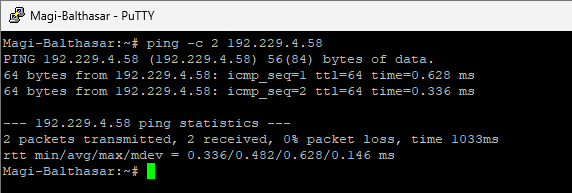
_Gambar 11-01. Balthasar mem-ping Casper sebelum rule dipasang (berhasil)._

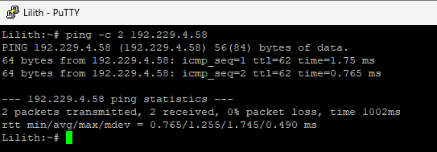
_Gambar 11-02. Lilith mem-ping Casper sebelum rule dipasang (berhasil)._

**Script `/root/casper-fw.sh`.** Opsi `-C` memeriksa apakah rule sudah ada, `||` menjalankan perintah di kanan hanya bila belum ada, dan `-I INPUT 1` menyisipkan rule di posisi paling atas.

```bash
cat > /root/casper-fw.sh <<'EOF'
#!/bin/bash
iptables -C INPUT -p icmp --icmp-type echo-request -j DROP 2>/dev/null || iptables -I INPUT 1 -p icmp --icmp-type echo-request -j DROP
EOF
bash /root/casper-fw.sh
grep -q casper-fw.sh /root/.bashrc || echo 'bash /root/casper-fw.sh' >> /root/.bashrc
```

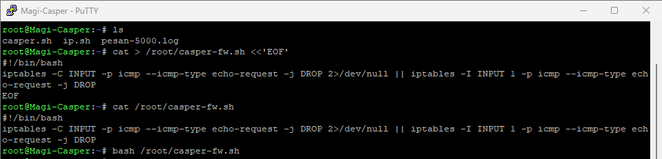
_Gambar 11-03. Isi script `casper-fw.sh` dan pemanggilannya._

Hasil rule di chain INPUT:

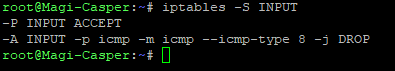
_Gambar 11-04. `iptables -S INPUT` di Casper memuat rule `--icmp-type 8 -j DROP`._

### Langkah Pengujian

#### Uji 1: Ping ke Casper gagal

**Membuktikan:** tidak ada perangkat lain, termasuk yang satu switch, yang bisa mem-ping Casper.

Perintah (dijalankan di **Balthasar**, lalu di **Lilith**):

```bash
ping -c 3 192.229.4.58
```

**Hasil:** `100% packet loss` (tidak ada balasan).

**Dokumentasi:** Balthasar mem-ping Casper: 100% packet loss.

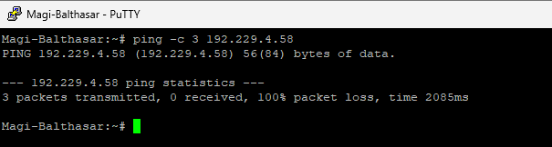

**Dokumentasi:** Lilith mem-ping Casper: 100% packet loss.

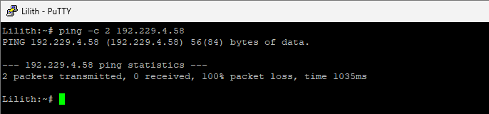

#### Uji 2: Casper masih bisa mem-ping keluar

**Membuktikan:** hanya ping yang masuk yang diblokir. Balasan ping milik Casper sendiri tidak ikut terbuang.

Perintah (dijalankan di **Casper**):

```bash
ping -c 3 192.229.4.59
ping -c 3 192.229.4.74
```

**Hasil:** `0% packet loss` ke Balthasar dan ke Lilith.

**Dokumentasi:** Casper mem-ping Balthasar: 0% packet loss.

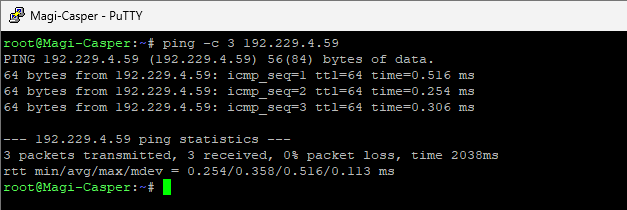

**Dokumentasi:** Casper mem-ping Lilith: 0% packet loss.

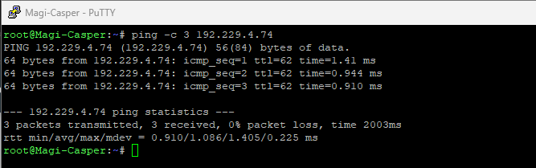

#### Uji 3: Rule benar-benar menangkap paket

**Membuktikan:** kegagalan ping pada Uji 1 memang disebabkan rule, bukan hal lain.

Perintah (di **Casper**):

```bash
iptables -L INPUT -v -n
```

**Hasil:** kolom `pkts` pada baris `DROP icmp type 8` lebih dari 0.

**Dokumentasi:** Counter rule DROP ICMP di Casper sudah bertambah.

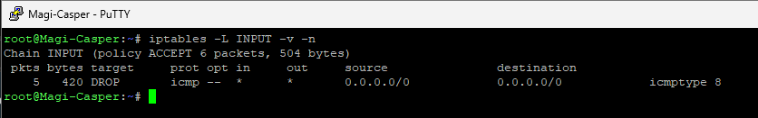

#### Uji 4: Layanan TCP 5000 tetap hidup

**Membuktikan:** rule hanya menyentuh ping dan tidak mengganggu layanan lain.

Perintah (di **Lilith**, lalu di **Casper**):

```bash
echo tes-soal11 | nc -w 3 192.229.4.58 5000
cat /root/pesan-5000.log
```

**Hasil:** tulisan `tes-soal11` muncul di log Casper.

**Dokumentasi:** Lilith mengirim pesan ke Casper port 5000.

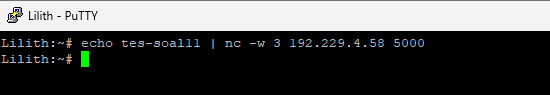

**Dokumentasi:** Pesan `tes-soal11` tercatat di log Casper.

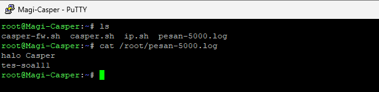

### Kesimpulan

Casper menjadi "hantu" karena hanya paket echo-request yang masuk yang dibuang di chain INPUT. Ping keluar dari Casper tetap berhasil karena balasannya berjenis echo-reply, dan layanan TCP 5000 tidak terpengaruh.

---

## Soal 12

### Soal

> **Teknisi yang kelewat semangat:** seorang teknisi menjalankan script hardening di Casper lalu pulang tanpa mengecek. Paginya Casper tidak bisa ping 8.8.8.8 dan tidak bisa apt-get update. Unit-00 juga tidak bisa menyambung ke TCP 5000 Casper. Ping ke Casper tetap ditolak, dan itu memang benar. Jalankan `break_fw.sh` di **Magi-Casper**, lalu perbaiki **tanpa membatalkan tujuan hardening**. Casper tetap menolak semua lalu lintas masuk yang tidak diizinkan, dan **policy INPUT tetap DROP**. Buktikan nc dari Unit-00 ke Casper port 5000 berhasil dan apt-get update di Casper berhasil.

### Tujuan

Melatih diagnosis firewall yang rusak: menemukan **semua** penyebab (bukan hanya satu), memahami hubungan tiap penyebab dengan gejalanya, lalu memperbaikinya sambil mempertahankan prinsip hardening (policy INPUT DROP dan ping masuk ditolak). Casper memakai Alpine, sehingga padanan `apt-get update` adalah `apk update`.

### Langkah Pengerjaan

**1. Rekam kondisi sehat sebelum dirusak.** Casper dapat mem-ping 8.8.8.8, `apk update` berhasil, Unit-00 dapat menyambung ke TCP 5000, dan rule awal Casper tersimpan.

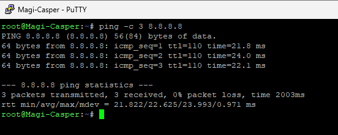
_Gambar 12-01. Casper mem-ping 8.8.8.8 sebelum dirusak (berhasil)._

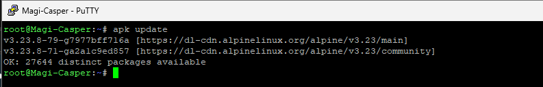
_Gambar 12-02. `apk update` di Casper sebelum dirusak (berhasil)._


_Gambar 12-03. Unit-00 menyambung ke Casper TCP 5000 sebelum dirusak (berhasil)._

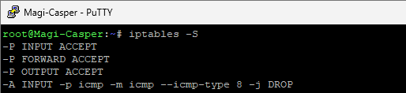
_Gambar 12-04. `iptables -S` Casper sebelum dirusak (hanya rule soal 11)._

**2. Unduh dan jalankan `break_fw.sh` tanpa membaca isinya.** Berkas diunduh dengan `curl` lalu dijalankan. Konsol sempat ter-clear setelah dijalankan, sehingga buktinya diambil dari riwayat perintah (`history`).

```bash
apk add curl
curl -L -o /root/break_fw.sh "https://drive.usercontent.google.com/download?id=1Yb5kX1NKafOGDTbAE7WMYHZkQgpWLTvZ&export=download&confirm=t"
bash /root/break_fw.sh
```

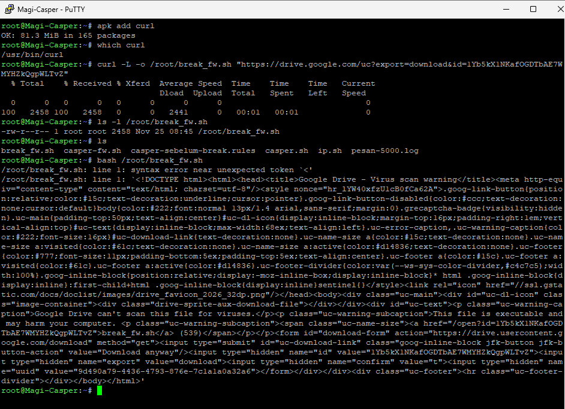
_Gambar 12-05. Riwayat perintah: unduh dan jalankan `break_fw.sh`._

**3. Buktikan gejala.** Setelah script berjalan, rule Casper berubah dan ketiga gejala muncul.

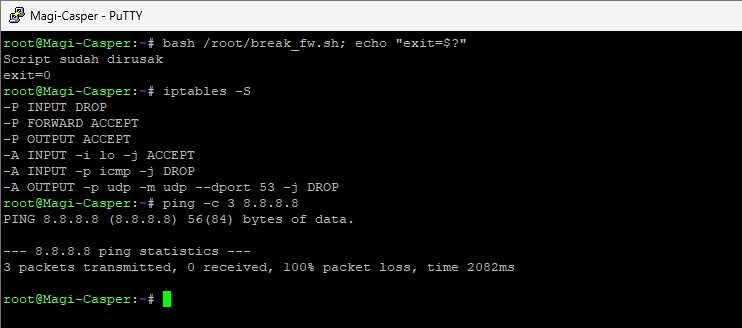
_Gambar 12-06. Script rusak dijalankan (`Script sudah dirusak`), isi iptables berubah, ping ke 8.8.8.8 gagal 100%._

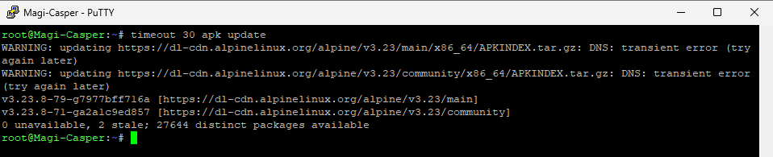
_Gambar 12-07. `apk update` gagal dengan `DNS: transient error`._

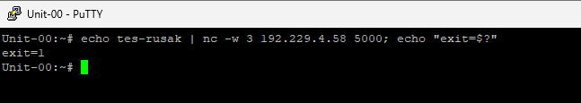
_Gambar 12-08. Unit-00 gagal menyambung ke TCP 5000 Casper (`exit=1`)._

**4. Diagnosis.** Seluruh bagian yang mungkin terganggu diperiksa: filter, nat, mangle, rute, dan DNS.


_Gambar 12-09. `iptables -S` setelah dirusak._

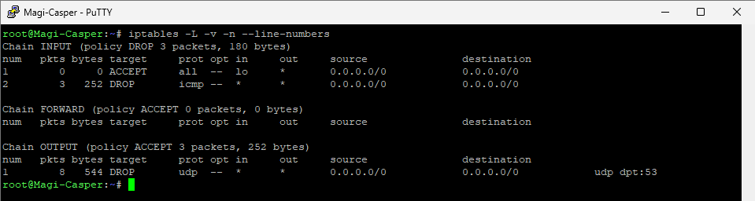
_Gambar 12-10. `iptables -L -v -n --line-numbers` setelah dirusak, lengkap dengan counter._

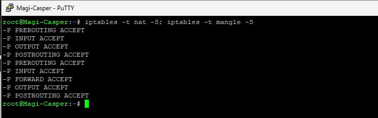
_Gambar 12-11. Tabel nat dan mangle: tidak ada rule, semua policy ACCEPT (bukan penyebab)._

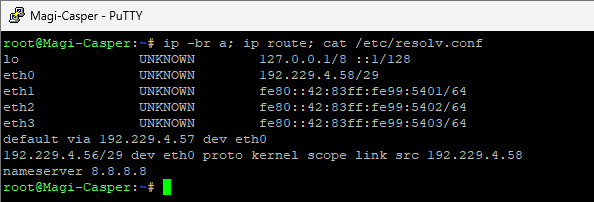
_Gambar 12-12. Alamat IP, rute (`default via 192.229.4.57`), dan `resolv.conf` (`nameserver 8.8.8.8`) normal (bukan penyebab)._

Kondisi setelah dirusak:

```
-P INPUT DROP
-A INPUT -i lo -j ACCEPT
-A INPUT -p icmp -j DROP
-A OUTPUT -p udp -m udp --dport 53 -j DROP
```

Ditemukan **empat penyebab**, dan masing-masing menjelaskan gejalanya:

| No  | Penyebab                                                                   | Gejala yang ditimbulkan                                                                                      | Bukti counter                                  |
| --- | -------------------------------------------------------------------------- | ------------------------------------------------------------------------------------------------------------ | ---------------------------------------------- |
| 1   | Tidak ada rule `ESTABLISHED,RELATED` di INPUT, sementara policy INPUT DROP | Semua balasan koneksi yang dimulai Casper (TCP, UDP) dibuang, sehingga `apk update` tidak bisa menerima data | Policy INPUT DROP menangkap 3 paket (180 byte) |
| 2   | `-A INPUT -p icmp -j DROP` terlalu luas dan ikut membuang echo-reply       | Casper mengirim ping ke 8.8.8.8, tetapi balasannya dibuang di pintu masuk, sehingga 100% loss                | Rule ICMP DROP menangkap 3 paket (252 byte)    |
| 3   | `-A OUTPUT -p udp --dport 53 -j DROP`                                      | Permintaan DNS tidak pernah keluar, sehingga nama domain tidak bisa di-resolve (`DNS: transient error`)      | Rule UDP 53 DROP menangkap 8 paket (544 byte)  |
| 4   | Tidak ada rule yang mengizinkan TCP 5000                                   | Koneksi Unit-00 ke port 5000 ditolak oleh policy INPUT DROP                                                  | (tercakup pada policy INPUT DROP)              |

**5. Perbaikan.** Policy INPUT tetap DROP. Yang ditambahkan hanya izin yang dibutuhkan: balasan koneksi (`ESTABLISHED,RELATED`), TCP 5000, dan loopback. Ping masuk tetap ditolak, tetapi kini hanya echo-request (type 8) sehingga balasan ping Casper sendiri tidak ikut terbuang. Rule penolak DNS dihapus.

```bash
cat > /root/casper-fw.sh <<'EOF'
#!/bin/bash
iptables -F INPUT
iptables -F OUTPUT
iptables -A INPUT -i lo -j ACCEPT
iptables -A INPUT -p icmp --icmp-type echo-request -j DROP
iptables -A INPUT -m conntrack --ctstate ESTABLISHED,RELATED -j ACCEPT
iptables -A INPUT -p tcp --dport 5000 -j ACCEPT
iptables -P INPUT DROP
grep -q "nameserver 8.8.8.8" /etc/resolv.conf || echo "nameserver 8.8.8.8" > /etc/resolv.conf
EOF
bash /root/casper-fw.sh
grep -q casper-fw.sh /root/.bashrc || echo 'bash /root/casper-fw.sh' >> /root/.bashrc
```

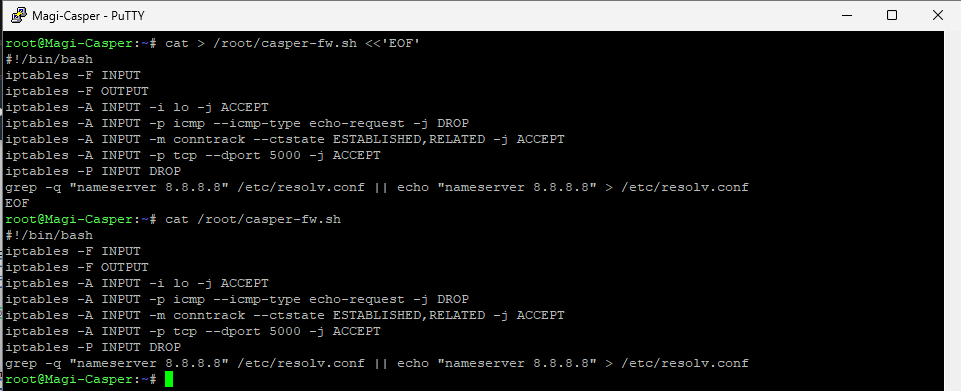
_Gambar 12-13. Script perbaikan `casper-fw.sh`._

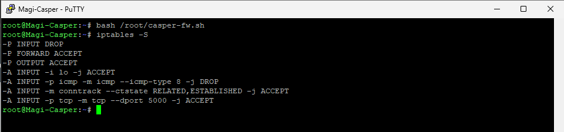
_Gambar 12-14. `iptables -S` Casper setelah perbaikan: `-P INPUT DROP` dipertahankan._

### Langkah Pengujian

#### Uji 1: Internet Casper pulih

**Membuktikan:** DNS dan balasan koneksi tidak lagi diblokir.

Perintah (di **Casper**):

```bash
ping -c 3 8.8.8.8
apk update
```

**Hasil:** ping `0% packet loss` dan `apk update` selesai tanpa `DNS: transient error`.

**Dokumentasi:** Casper mem-ping 8.8.8.8: berhasil.

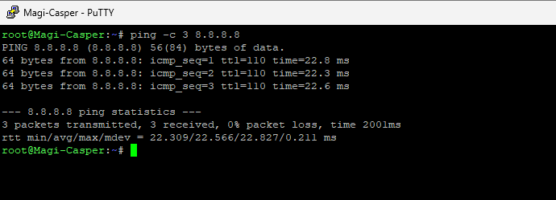

**Dokumentasi:** `apk update` berhasil.

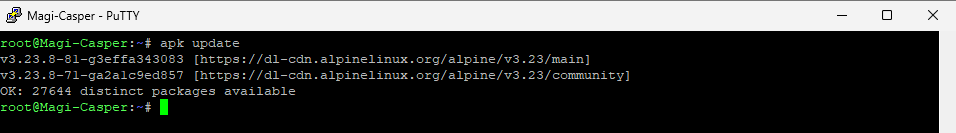

#### Uji 2: TCP 5000 dapat diakses Unit-00

**Membuktikan:** port 5000 sudah diizinkan di INPUT.

Perintah (di **Unit-00**, lalu di **Casper**):

```bash
echo "tes-soal12" | nc -w 3 192.229.4.58 5000; echo "exit=$?"
cat /root/pesan-5000.log
```

**Hasil:** `exit=0` dan pesan muncul di log Casper.

**Dokumentasi:** Unit-00 mengirim pesan ke Casper port 5000: `exit=0`.

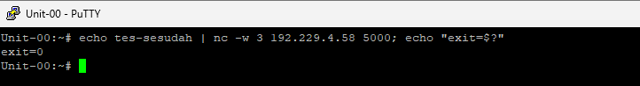

**Dokumentasi:** Pesan dari Unit-00 muncul di log Casper.

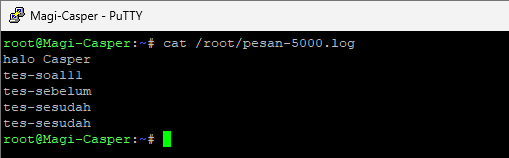

#### Uji 3: Tujuan hardening tetap utuh

**Membuktikan:** perbaikan tidak membatalkan hardening, yaitu ping masuk tetap ditolak.

Perintah (di **Balthasar**):

```bash
ping -c 3 192.229.4.58
```

**Hasil:** `100% packet loss`.

**Dokumentasi:** Balthasar mem-ping Casper: tetap gagal.

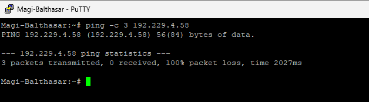

#### Uji 4: Rule bekerja sesuai rancangan

**Membuktikan:** setiap rule menangkap paket yang tepat dan policy INPUT tetap DROP.

Perintah (di **Casper**):

```bash
iptables -L INPUT -v -n
```

**Hasil:** policy `DROP`, rule `lo` 8 paket, ICMP type 8 DROP 3 paket, `RELATED,ESTABLISHED` 2044 paket, TCP 5000 ACCEPT 1 paket.

**Dokumentasi:** Counter Casper setelah perbaikan.

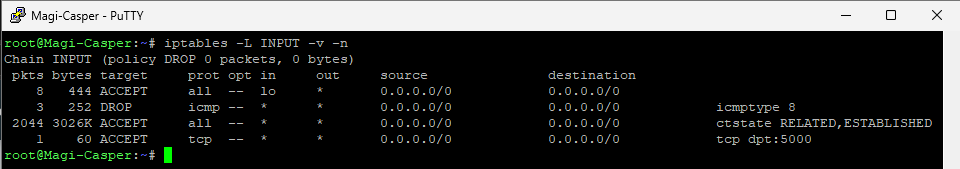

### Kesimpulan

Kegagalan Casper berasal dari empat penyebab sekaligus pada firewall: tidak ada izin balasan koneksi, rule ICMP yang terlalu luas, pemblokiran DNS keluar, dan tidak adanya izin TCP 5000. Setelah rule diperbaiki dengan tetap mempertahankan policy INPUT DROP, Casper dapat mengakses internet dan melayani port 5000, sementara ping masuk tetap ditolak.

---

## Soal 13

### Soal

> **Brankas Balthasar:** Balthasar menyimpan seluruh data Geofront, tapi terlalu banyak yang bisa mengetuk pintunya, termasuk tetangga satu switch. **Hanya Casper dan semua Pilot** yang boleh menyambung ke **TCP 5000 dan 5001**. Node lain, termasuk yang satu switch, harus **langsung ditolak** di kedua port itu, bukan dibiarkan menggantung sampai timeout. Lalu lintas lain tidak boleh terganggu. Balthasar tetap harus bisa ping 8.8.8.8 dan menerima balasannya. Buktikan nc ke port 5000 dan 5001: **Unit-01 berhasil, Lilith dan Melchior ditolak seketika**.

### Tujuan

Membatasi akses ke port layanan sensitif berdasarkan alamat sumber, dengan penolakan yang **seketika** (`REJECT --reject-with tcp-reset`), bukan `DROP` yang membuat klien menunggu sampai timeout. Soal ini juga menekankan pentingnya **urutan rule**: rule `ACCEPT` untuk pihak yang diizinkan harus lebih dulu daripada rule penolak.

### Langkah Pengerjaan

Pihak yang diizinkan: Casper (`192.229.4.58`) dan semua Pilot, yaitu Unit-01 (`.66`), Unit-02 (`.67`), Unit-00 (`.68`), serta Sachiel (`192.229.3.130`). Rule hanya menyentuh TCP 5000 dan 5001, sehingga lalu lintas lain (termasuk ping ke 8.8.8.8) tidak terganggu. Policy INPUT tidak diubah.

**Kondisi awal.** Balthasar (Alpine) belum memiliki rule, dan listener 5000 serta 5001 sudah hidup.

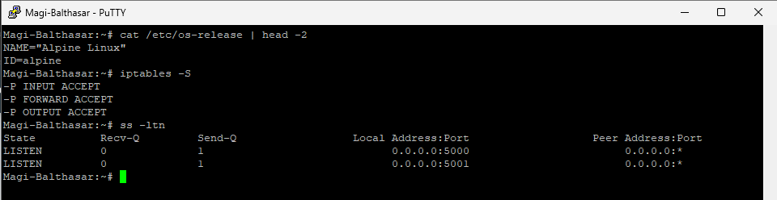
_Gambar 13-01. Balthasar: OS Alpine, `iptables -S` kosong, listener 5000 dan 5001 `LISTEN`._

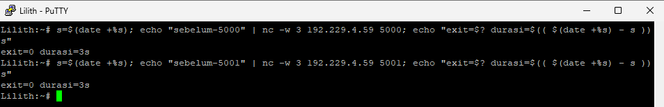
_Gambar 13-02. Sebelum rule: Lilith masih dapat menyambung ke Balthasar port 5000 dan 5001._

**Script `/root/balthasar-fw.sh`:**

```bash
cat > /root/balthasar-fw.sh <<'EOF'
#!/bin/bash
iptables -F INPUT
iptables -A INPUT -p tcp -m multiport --dports 5000,5001 -s 192.229.4.58,192.229.4.66,192.229.4.67,192.229.4.68,192.229.3.130 -j ACCEPT
iptables -A INPUT -p tcp -m multiport --dports 5000,5001 -j REJECT --reject-with tcp-reset
EOF
bash /root/balthasar-fw.sh
grep -q balthasar-fw /root/.bashrc || echo 'bash /root/balthasar-fw.sh' >> /root/.bashrc
```

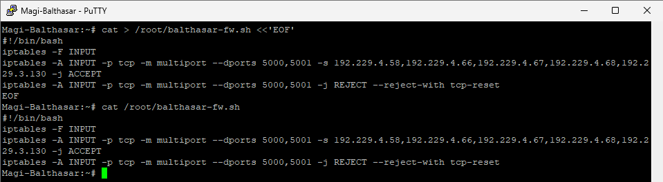
_Gambar 13-03. Isi script `balthasar-fw.sh`._

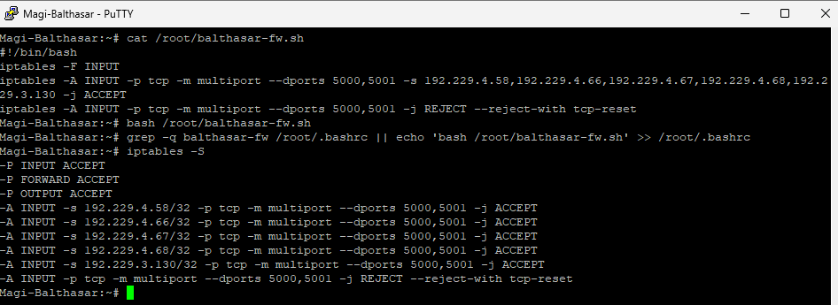
_Gambar 13-04. `iptables -S` Balthasar setelah rule dipasang: rule ACCEPT di atas, REJECT tcp-reset di bawah._

### Langkah Pengujian

Semua uji TCP memakai satu pola perintah. Pola ini menampilkan kode keluar (`exit`) dan lama koneksi (`durasi`). Ganti `PORT` dengan `5000` atau `5001`.

```bash
s=$(date +%s); echo "tes-soal13" | nc -w 3 192.229.4.59 PORT; echo "exit=$? durasi=$(( $(date +%s) - s ))s"
```

Arti hasil: `exit=0` berarti tersambung. `exit=1 durasi=0s` berarti **ditolak seketika**. Jika `durasi` mendekati 3 detik, berarti paket dibuang diam-diam (timeout), dan itu bukan hasil yang diminta soal.

#### Uji 1: Pilot (Unit-01) berhasil

**Membuktikan:** Pilot diizinkan di kedua port.

Perintah: pola di atas dijalankan di **Unit-01** untuk `PORT` 5000 dan 5001.

**Hasil:** `exit=0`.

**Dokumentasi:** Unit-01 ke port 5000: `exit=0`.

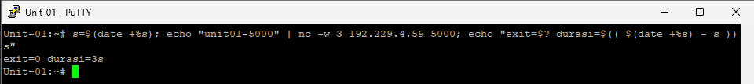

**Dokumentasi:** Unit-01 ke port 5001: `exit=0`.

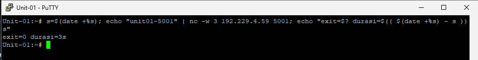

#### Uji 2: Lilith ditolak seketika

**Membuktikan:** node di luar daftar ditolak, dan penolakan berupa reset, bukan menggantung.

Perintah: pola di atas di **Lilith** untuk port 5000 dan 5001.

**Hasil:** `exit=1 durasi=0s`.

**Dokumentasi:** Lilith ke port 5000: ditolak seketika.

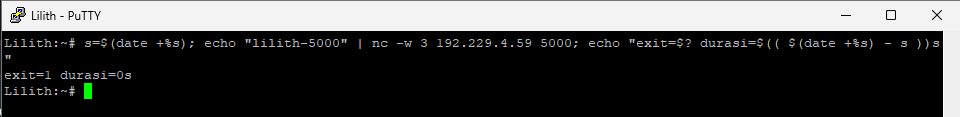

**Dokumentasi:** Lilith ke port 5001: ditolak seketika.

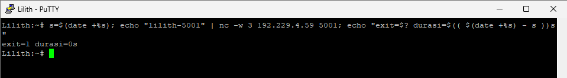

#### Uji 3: Melchior (satu switch) ditolak seketika

**Membuktikan:** tetangga satu switch juga ikut diblokir.

Perintah: pola di atas di **Melchior** untuk port 5000 dan 5001.

**Hasil:** `exit=1 durasi=0s`.

**Dokumentasi:** Melchior ke port 5000: ditolak seketika.

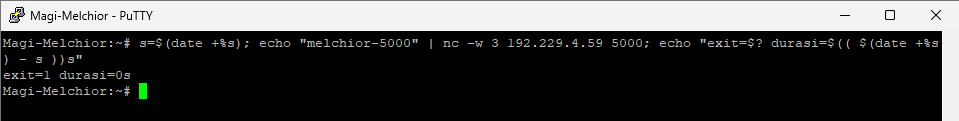

**Dokumentasi:** Melchior ke port 5001: ditolak seketika.

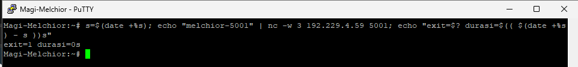

#### Uji 4: Lalu lintas lain tidak terganggu

**Membuktikan:** rule hanya menyentuh port 5000 dan 5001.

Perintah (di **Balthasar**):

```bash
ping -c 3 8.8.8.8
```

**Hasil:** `0% packet loss`.

**Dokumentasi:** Balthasar mem-ping 8.8.8.8: berhasil.

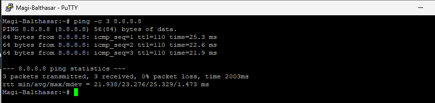

#### Uji 5: Counter dan log pesan

**Membuktikan:** rule ACCEPT dan REJECT bekerja, dan hanya pesan dari pihak yang diizinkan yang masuk.

Perintah (di **Balthasar**):

```bash
iptables -L INPUT -v -n
cat /root/pesan-*.log
```

**Hasil:** counter ACCEPT dan REJECT lebih dari 0, dan log hanya berisi pesan dari Unit-01.

**Dokumentasi:** Counter rule ACCEPT dan REJECT di Balthasar.

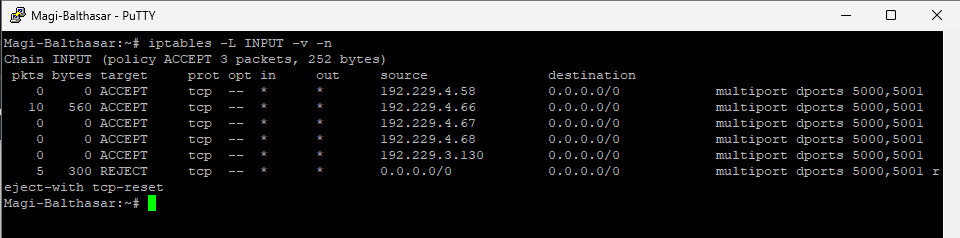

**Dokumentasi:** Log pesan Balthasar hanya berisi pesan Unit-01.

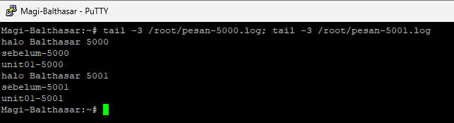

#### Uji 6: Casper dan Sachiel juga diizinkan

**Membuktikan:** seluruh daftar izin bekerja, tidak hanya Unit-01.

Perintah: pola di atas di **Casper** dan di **Sachiel** (port 5000 dan 5001).

**Hasil:** `exit=0`.

**Dokumentasi:** Casper menyambung ke Balthasar: berhasil.

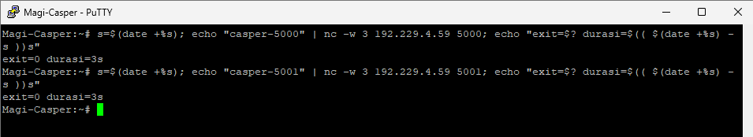

**Dokumentasi:** Sachiel menyambung ke Balthasar: berhasil.

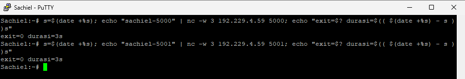

### Kesimpulan

Akses ke TCP 5000 dan 5001 Balthasar kini hanya terbuka bagi Casper dan para Pilot. Node lain, termasuk Melchior yang satu switch, ditolak seketika dengan TCP reset, dan lalu lintas lain Balthasar tidak terganggu.

---

## Soal 14

### Soal

> **Jam kunjungan sang pinguin:** Pen-Pen, pinguin Misato, menyimpan sesuatu yang bikin banyak orang penasaran. Ia hanya boleh dihubungi sesuai jadwal di bawah. Jadwal berlaku untuk **ping dan TCP 80** ke Pen-Pen, dari mana pun asalnya. **Jam komputer tidak boleh diubah.**
>
> | Kelompok                 | Jadwal                 | Keterangan                   |
> | :----------------------- | :--------------------- | :--------------------------- |
> | **Pilot**                | 08.00 sampai 16.00 WIB | Hanya **Senin sampai Jumat** |
> | **Staf Geofront**        | 17.00 sampai 23.00 WIB | **Setiap hari**              |
> | **Terduga Dummy System** | Tidak pernah           | Selalu ditolak               |
> | **Lainnya**              | Bebas                  | Tanpa batasan                |
>
> Simpan jadwal sebagai variabel di awal script Pen-Pen, bernama PILOT_START, PILOT_STOP, PILOT_DAYS, STAF_START, dan STAF_STOP. Untuk uji, ubah variabel itu sampai jadwalnya **cocok** dengan jam sekarang, lalu sampai **tidak cocok**. Ingat, iptables membaca **jam UTC, 7 jam lebih lambat dari WIB**. Tunjukkan hasil ping dari Unit-01, Lilith, dan Spy pada kedua kondisi.

### Tujuan

Menerapkan pembatasan akses berbasis waktu dengan modul `time` iptables, termasuk konversi **WIB ke UTC** (iptables membaca UTC), pembatasan hari (`--weekdays`), dan pembedaan perlakuan antarkelompok node. Variabel jadwal ditulis dalam WIB di awal script agar mudah diubah, lalu dikonversi otomatis.

### Langkah Pengerjaan

Kelompok yang dipakai:

| Kelompok      | Node (alamat)                                                                 |
| ------------- | ----------------------------------------------------------------------------- |
| Pilot         | Unit-01 `192.229.4.66`, Unit-02 `.67`, Unit-00 `.68`, Sachiel `192.229.3.130` |
| Staf Geofront | Lilith `192.229.4.74`, Adam `192.229.4.75`                                    |
| Terduga Dummy | Entry-Plug `192.229.4.50`, Dummy-Plug `.51`, Spy `192.229.4.102`              |
| Lainnya       | node lain (tidak dikenai rule)                                                |

Konversi jadwal ke UTC: pilot 08.00 sampai 16.00 WIB menjadi **01:00 sampai 09:00 UTC**, staf 17.00 sampai 23.00 WIB menjadi **10:00 sampai 16:00 UTC**. Keduanya tetap pada hari yang sama, sehingga nama hari tidak bergeser. Konversi dilakukan script dengan fungsi `to_utc()` yang memakai `TZ=WIB-7` (tidak membutuhkan paket `tzdata`).

Pada tiap kelompok ada dua rule: `ACCEPT` pada jam yang cocok, lalu rule penolak untuk waktu lainnya (`DROP` untuk ping, `REJECT` tcp-reset untuk TCP 80). Kelompok Dummy selalu ditolak.

**Pemeriksaan awal.** Modul `time` tersedia dan jam node dicatat.

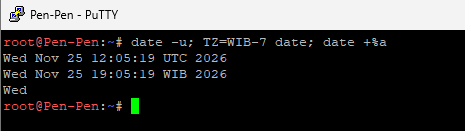
_Gambar 14-01. Modul `time` tersedia (`--timestart`, `--weekdays`), rule percobaan berhasil, dan jam node ditampilkan._

**Script `/root/penpen-fw.sh`:**

```bash
cat > /root/penpen-fw.sh <<'EOF'
#!/bin/bash
# Jadwal dalam WIB (script mengubahnya ke UTC karena iptables membaca UTC)
PILOT_START="08:00"
PILOT_STOP="16:00"
PILOT_DAYS="Mon,Tue,Wed,Thu,Fri"
STAF_START="17:00"
STAF_STOP="23:00"

PILOT="192.229.4.66,192.229.4.67,192.229.4.68,192.229.3.130"
STAF="192.229.4.74,192.229.4.75"
DUMMY="192.229.4.50,192.229.4.51,192.229.4.102"

to_utc() { date -u -d "@$(TZ=WIB-7 date -d "2000-01-02 $1" +%s)" +%H:%M; }
P1=$(to_utc "$PILOT_START"); P2=$(to_utc "$PILOT_STOP")
S1=$(to_utc "$STAF_START");  S2=$(to_utc "$STAF_STOP")

iptables -F INPUT

# Terduga Dummy System: selalu ditolak
iptables -A INPUT -s $DUMMY -p icmp --icmp-type echo-request -j DROP
iptables -A INPUT -s $DUMMY -p tcp --dport 80 -j REJECT --reject-with tcp-reset

# Pilot: hanya jam dan hari yang cocok
iptables -A INPUT -s $PILOT -p icmp --icmp-type echo-request -m time --timestart $P1 --timestop $P2 --weekdays $PILOT_DAYS -j ACCEPT
iptables -A INPUT -s $PILOT -p icmp --icmp-type echo-request -j DROP
iptables -A INPUT -s $PILOT -p tcp --dport 80 -m time --timestart $P1 --timestop $P2 --weekdays $PILOT_DAYS -j ACCEPT
iptables -A INPUT -s $PILOT -p tcp --dport 80 -j REJECT --reject-with tcp-reset

# Staf Geofront: hanya jam yang cocok, setiap hari
iptables -A INPUT -s $STAF -p icmp --icmp-type echo-request -m time --timestart $S1 --timestop $S2 -j ACCEPT
iptables -A INPUT -s $STAF -p icmp --icmp-type echo-request -j DROP
iptables -A INPUT -s $STAF -p tcp --dport 80 -m time --timestart $S1 --timestop $S2 -j ACCEPT
iptables -A INPUT -s $STAF -p tcp --dport 80 -j REJECT --reject-with tcp-reset
EOF
bash /root/penpen-fw.sh
grep -q penpen-fw /root/.bashrc || echo 'bash /root/penpen-fw.sh' >> /root/.bashrc
```

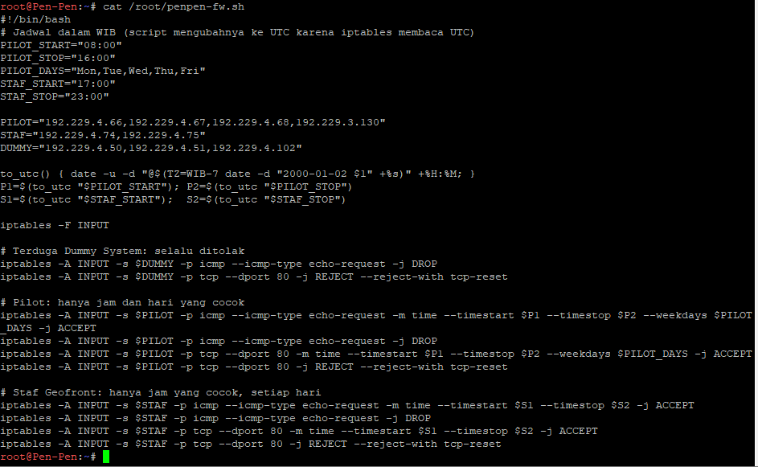
_Gambar 14-02. Isi script `penpen-fw.sh` dengan variabel jadwal di bagian awal._

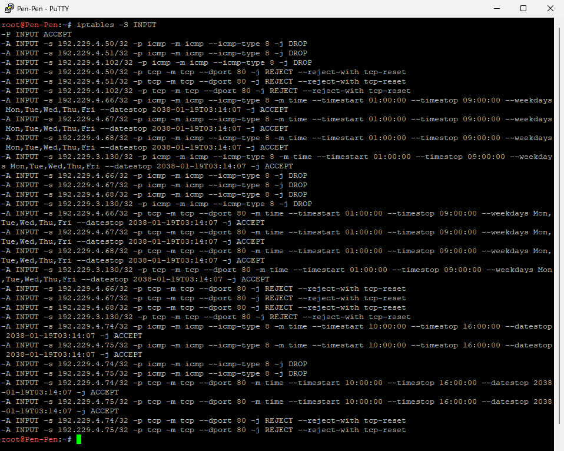
_Gambar 14-03. `iptables -S INPUT` di Pen-Pen: jadwal pilot `01:00-09:00` UTC (Senin sampai Jumat) dan staf `10:00-16:00` UTC._

(Daftar rule tampak panjang karena iptables memecah daftar alamat `-s a,b,c` menjadi satu rule per alamat.)

### Langkah Pengujian

Jadwal diuji dengan mengubah variabel di script, **tanpa mengubah jam komputer**. Jam node dilihat dengan perintah ini (di **Pen-Pen**):

```bash
TZ=WIB-7 date
```

#### Uji 1: Jadwal COCOK dengan jam sekarang

**Membuktikan:** pada jam yang sesuai jadwal, Pilot dan Staf boleh mem-ping Pen-Pen, sedangkan Spy (Terduga Dummy) tetap ditolak.

Perintah (di **Pen-Pen**). Jendela diubah ke `18:00` sampai `21:00`, sedangkan jam node saat itu sekitar `19:09` WIB:

```bash
sed -i 's/^PILOT_START=.*/PILOT_START="18:00"/; s/^PILOT_STOP=.*/PILOT_STOP="21:00"/; s/^STAF_START=.*/STAF_START="18:00"/; s/^STAF_STOP=.*/STAF_STOP="21:00"/' /root/penpen-fw.sh
bash /root/penpen-fw.sh
```

**Dokumentasi:** Variabel jadwal pada kondisi cocok beserta jam node.

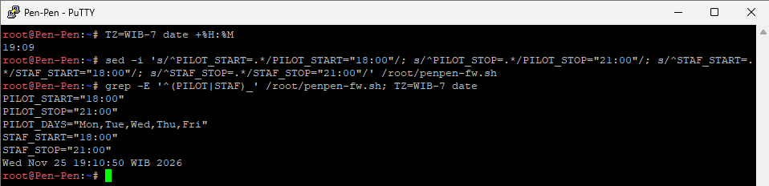

Perintah (di **Unit-01**, **Lilith**, dan **Spy**):

```bash
ping -c 3 192.229.3.194
```

**Hasil:** Unit-01 dan Lilith berhasil, Spy gagal.

**Dokumentasi:** Unit-01 mem-ping Pen-Pen: berhasil.

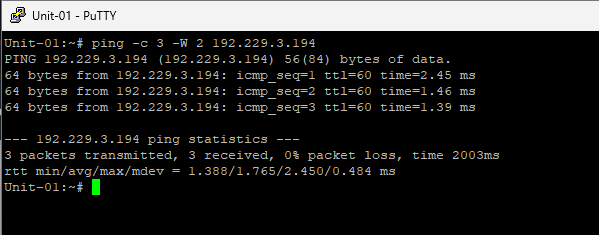

**Dokumentasi:** Lilith mem-ping Pen-Pen: berhasil.

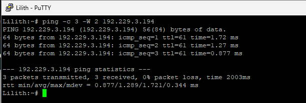

**Dokumentasi:** Spy mem-ping Pen-Pen: gagal (selalu ditolak).


#### Uji 2: Jadwal TIDAK COCOK

**Membuktikan:** di luar jadwal, semua kelompok yang dibatasi ditolak.

Perintah (di **Pen-Pen**). Jendela diubah ke `03:00` sampai `04:00`:

```bash
sed -i 's/^PILOT_START=.*/PILOT_START="03:00"/; s/^PILOT_STOP=.*/PILOT_STOP="04:00"/; s/^STAF_START=.*/STAF_START="03:00"/; s/^STAF_STOP=.*/STAF_STOP="04:00"/' /root/penpen-fw.sh
bash /root/penpen-fw.sh
```

**Dokumentasi:** Variabel jadwal pada kondisi tidak cocok.


Perintah (di **Unit-01**, **Lilith**, dan **Spy**):

```bash
ping -c 3 192.229.3.194
```

**Hasil:** ketiganya gagal (`100% packet loss`).

**Dokumentasi:** Unit-01 mem-ping Pen-Pen: gagal.


**Dokumentasi:** Lilith mem-ping Pen-Pen: gagal.


**Dokumentasi:** Spy mem-ping Pen-Pen: gagal.


#### Uji 3: Bukti tambahan (counter, TCP 80, kelompok Lainnya)

**Membuktikan:** rule benar-benar menangkap paket, jadwal juga berlaku untuk TCP 80, dan node di luar ketiga kelompok tetap bebas.

Perintah (di **Pen-Pen**, lalu **Lilith**, lalu **Melchior**):

```bash
iptables -L INPUT -v -n
echo "tes" | nc -w 3 192.229.3.194 80; echo "exit=$?"
ping -c 3 192.229.3.194
```

**Hasil:** counter DROP bertambah, Lilith ke TCP 80 ditolak (`exit=1`) pada jadwal tidak cocok, dan Melchior (kelompok Lainnya) berhasil mem-ping.

**Dokumentasi:** Counter rule di Pen-Pen.


**Dokumentasi:** Lilith ke Pen-Pen TCP 80 pada jadwal tidak cocok: ditolak.


**Dokumentasi:** Melchior mem-ping Pen-Pen: berhasil tanpa batasan.


#### Uji 4: Jadwal dikembalikan ke nilai soal

**Membuktikan:** setelah uji selesai, script kembali memakai jadwal asli.

Perintah (di **Pen-Pen**):

```bash
sed -i 's/^PILOT_START=.*/PILOT_START="08:00"/; s/^PILOT_STOP=.*/PILOT_STOP="16:00"/; s/^STAF_START=.*/STAF_START="17:00"/; s/^STAF_STOP=.*/STAF_STOP="23:00"/' /root/penpen-fw.sh
bash /root/penpen-fw.sh
```

**Hasil:** variabel kembali `08:00`, `16:00`, `17:00`, `23:00`.

**Dokumentasi:** Variabel jadwal dikembalikan ke nilai pada soal.


### Kesimpulan

Akses ping dan TCP 80 ke Pen-Pen kini mengikuti jadwal per kelompok: Pilot pada jam kerja Senin sampai Jumat, Staf Geofront pada jam malam setiap hari, Terduga Dummy selalu ditolak, dan node lain bebas. Pengujian pada kondisi cocok dan tidak cocok memberi hasil yang berbeda tanpa mengubah jam komputer.

---

## Soal 15

### Soal

> **Banjir ping di pusat komando:** Instrumentality makin dekat, dan semua orang berebut mem-ping Tokyo3-Core. Banjir ping bisa melumpuhkannya. Batasi Tokyo3-Core agar hanya menjawab maksimal 5 ping per detik, dan buang kelebihannya. Aturan ini tidak boleh mengganggu ping di bawah batas. Aturan ini juga tidak boleh membatasi ping yang dikirim Tokyo3-Core sendiri. Pastikan rule benar-benar mengenai paket yang dituju. Periksa urutan rule dan jenis paketnya. Buktikan ping rapat dari Lilith, misalnya ping -i 0.1 -c50, sebagian hilang, dan tunjukkan counter rule pembuangan naik. Buktikan ping biasa semuanya berhasil, dengan jeda minimal 3 detik di antaranya.

### Tujuan

Membatasi laju ping yang masuk ke Tokyo3-Core (rate limiting) dengan modul `limit` iptables. Pemahaman kuncinya: rule harus mengenai **jenis paket** yang tepat (echo-request type 8, bukan echo-reply), berada di chain yang tepat (INPUT, karena Tokyo3-Core adalah tujuan), dan **urutannya benar** (ACCEPT bersyarat dahulu, DROP sesudahnya).

### Langkah Pengerjaan

Tokyo3-Core (Debian 13) awalnya tanpa rule. Dua rule ditambahkan secara berurutan:

1. `ACCEPT` echo-request selama laju di bawah 5 paket per detik (`-m limit --limit 5/second --limit-burst 5`).
2. `DROP` echo-request yang tersisa (kelebihan).

Tanpa rule `DROP`, semua ping tetap lolos karena policy INPUT adalah ACCEPT. Ping yang dikirim Tokyo3-Core sendiri tidak terdampak karena balasannya berjenis echo-reply (type 0) dan rule hanya memeriksa type 8.

**Kondisi awal:**


_Gambar 15-01. Tokyo3-Core: Debian 13, `iptables -S` kosong (semua policy ACCEPT)._


_Gambar 15-02. Sebelum rule: `ping -i 0.1 -c 50` dari Lilith, 0% packet loss._

**Script `/root/tokyo3core-fw.sh`.** Fungsi `ipt()` memeriksa dulu apakah rule sudah ada (`-C`) sehingga script aman diulang dan tidak menghapus rule lain.

```bash
cat > /root/tokyo3core-fw.sh <<'EOF'
#!/bin/bash
ipt() { iptables -C "$@" 2>/dev/null || iptables -A "$@"; }
ipt INPUT -p icmp --icmp-type echo-request -m limit --limit 5/second --limit-burst 5 -j ACCEPT
ipt INPUT -p icmp --icmp-type echo-request -j DROP
EOF
bash /root/tokyo3core-fw.sh
grep -q tokyo3core-fw /root/.bashrc || echo 'bash /root/tokyo3core-fw.sh' >> /root/.bashrc
```


_Gambar 15-03. Isi script `tokyo3core-fw.sh`._


_Gambar 15-04. `iptables -S INPUT` Tokyo3-Core: rule limit 5/sec dan rule DROP berurutan._

### Langkah Pengujian

#### Uji 1: Ping rapat sebagian hilang

**Membuktikan:** ping yang melebihi 5 per detik dibuang.

Perintah: nolkan counter di **Tokyo3-Core**, lalu kirim 50 ping (10 per detik) dari **Lilith**:

```bash
iptables -Z INPUT
ping -i 0.1 -c 50 192.229.4.106
```

**Hasil:** ada `packet loss` (sebagian paket hilang).

**Dokumentasi:** Ping rapat dari Lilith: sebagian paket hilang.


#### Uji 2: Counter pembuangan naik

**Membuktikan:** kehilangan paket pada Uji 1 disebabkan rule `DROP`, bukan gangguan jaringan.

Perintah (di **Tokyo3-Core**):

```bash
iptables -L INPUT -v -n -x
```

**Hasil:** kolom `pkts` pada rule `DROP` lebih dari 0.

**Dokumentasi:** Counter rule DROP di Tokyo3-Core bertambah.


#### Uji 3: Ping biasa semuanya berhasil

**Membuktikan:** ping di bawah batas tidak terganggu.

Perintah (di **Lilith**), jeda 3 detik per paket:

```bash
ping -c 5 -i 3 192.229.4.106
```

**Hasil:** `0% packet loss`.

**Dokumentasi:** Ping biasa dari Lilith: 0% packet loss.


#### Uji 4: Ping keluar Tokyo3-Core tidak dibatasi

**Membuktikan:** rule hanya membatasi ping yang masuk (echo-request), bukan ping yang dikirim Tokyo3-Core sendiri.

Perintah (di **Tokyo3-Core**):

```bash
ping -i 0.1 -c 30 192.229.4.74
```

**Hasil:** `0% packet loss`.

**Dokumentasi:** Tokyo3-Core mem-ping Lilith secara rapat: 0% packet loss.


### Kesimpulan

Tokyo3-Core kini hanya menjawab maksimal 5 ping per detik dan membuang kelebihannya. Ping biasa tetap berhasil seluruhnya, dan ping keluar dari Tokyo3-Core tidak dibatasi karena rule hanya mengenai echo-request yang masuk.

---

## Soal 16

### Soal

> **Pencuri yang mencoba setiap pintu:** dari Switch-Lab, Dummy-Plug mengetuk port sensitif Tokyo3-Core satu per satu seperti pencuri. Ritsuko ingin tahu setiap percobaannya, dan pintunya harus dibanting. Setiap koneksi TCP dari **Dummy-Plug** ke **port 22, 23, dan 3306** di Tokyo3-Core harus **dicatat di log** dengan prefix huruf besar SCAN-NERV:, lalu **ditolak seketika**. Port 80 dan 8080 tetap bisa diakses, dan klien lain tidak boleh terganggu. Buktikan nc -w dari Dummy-Plug ke port 22, 23, dan 3306 langsung ditolak, dan ke port 80 dan 8080 berhasil. Tunjukkan **counter rule pencatatan**, karena log kernel sering tidak terlihat di container.

### Tujuan

Mencatat (logging) dan menolak seketika percobaan koneksi dari satu sumber ke port tertentu. Konsep kuncinya: target `LOG` bersifat **non-terminating** (hanya mencatat, paket lanjut ke rule berikutnya), sehingga harus diletakkan **sebelum** rule `REJECT`. Bukti pencatatan diambil dari counter rule karena log kernel di container sering tidak terlihat.

### Langkah Pengerjaan

Dua rule ditambahkan ke script yang sama dengan soal 15 (tanda `>>` menambah isi tanpa menghapus yang lama). Rule hanya mencocokkan sumber `192.229.4.51` (Dummy-Plug), TCP, port 22, 23, 3306, dan koneksi baru (`--ctstate NEW`) agar satu percobaan menghasilkan satu catatan.

```bash
cat >> /root/tokyo3core-fw.sh <<'EOF'
ipt INPUT -s 192.229.4.51 -p tcp -m multiport --dports 22,23,3306 -m conntrack --ctstate NEW -j LOG --log-prefix "SCAN-NERV: "
ipt INPUT -s 192.229.4.51 -p tcp -m multiport --dports 22,23,3306 -j REJECT --reject-with tcp-reset
EOF
bash /root/tokyo3core-fw.sh
```


_Gambar 16-01. Script `tokyo3core-fw.sh` setelah ditambah rule soal 16 (rule soal 15 tetap ada)._


_Gambar 16-02. `iptables -S INPUT`: rule LOG `SCAN-NERV: ` lalu REJECT, tanpa rule dobel._

### Langkah Pengujian

#### Uji 1: Port 22, 23, 3306 ditolak seketika

**Membuktikan:** koneksi dari Dummy-Plug ke port sensitif langsung ditolak.

Perintah (di **Dummy-Plug**). Ulangi untuk port `23` dan `3306`:

```bash
s=$(date +%s); nc -w 3 192.229.4.106 22 < /dev/null; echo "exit=$? durasi=$(( $(date +%s) - s ))s"
```

**Hasil:** `exit=1 durasi=0s` untuk ketiga port.

**Dokumentasi:** Dummy-Plug ke port 22, 23, 3306: ditolak seketika.


#### Uji 2: Port 80 dan 8080 tetap bisa diakses

**Membuktikan:** rule hanya mengenai port yang disebut soal.

Perintah (di **Dummy-Plug**):

```bash
nc -w 3 192.229.4.106 80
nc -w 3 192.229.4.106 8080
```

**Hasil:** port 80 menampilkan `Welcome to Tokyo3-Core`, port 8080 menampilkan `syifa imutz`.

**Dokumentasi:** Dummy-Plug ke port 80 dan 8080: berhasil.


#### Uji 3: Counter rule pencatatan

**Membuktikan:** setiap percobaan tercatat. Bukti memakai counter karena log kernel sering tidak terlihat di container.

Perintah (di **Tokyo3-Core**):

```bash
iptables -L INPUT -v -n -x
```

**Hasil:** rule `LOG` dan rule `REJECT` masing-masing mencatat **3 paket**, sesuai tiga percobaan pada Uji 1.

**Dokumentasi5:** Counter rule LOG dan REJECT bertambah menjadi 3.


#### Uji 4: Klien lain tidak terganggu

**Membuktikan:** hanya Dummy-Plug yang dicatat dan ditolak.

Perintah: akses port 80 dari **Lilith**, lalu cek counter lagi di **Tokyo3-Core**:

```bash
nc -w 3 192.229.4.106 80
iptables -L INPUT -v -n -x
```

**Hasil:** Lilith berhasil, dan counter tetap 3.

**Dokumentasi:** Lilith ke port 80: berhasil.


**Dokumentasi:** Counter tetap 3: aktivitas Lilith tidak dicatat.


#### Uji 5: Pemeriksaan log kernel

**Membuktikan:** upaya mencari tulisan `SCAN-NERV` di log kernel (bisa kosong di container, sehingga bukti utamanya adalah Uji 3).

Perintah (di **Tokyo3-Core**):

```bash
dmesg | grep SCAN-NERV
```

**Dokumentasi:** Pemeriksaan log kernel untuk prefix SCAN-NERV.


### Kesimpulan

Setiap koneksi dari Dummy-Plug ke port 22, 23, dan 3306 di Tokyo3-Core dicatat dengan prefix `SCAN-NERV: ` lalu ditolak seketika, sedangkan port 80, 8080, dan klien lain tidak terganggu. Bukti pencatatan ditunjukkan lewat counter rule LOG.

---

## Soal 17

### Soal

> **Sihir hitam di jalur paket:** Ritsuko meninggalkan memo di meja Gendo. Paket dari Casper ke Zeruel tidak pernah sampai ke Zeruel, karena ada router yang diam-diam mengalihkannya ke tempat lain. _"Cari saja router yang menjadi gateway Switch-Terminal."_ Gendo menyuruhmu meniru router yang diam-diam itu untuk menjebak siapa pun. Di **Fuyutsuki**, alihkan setiap koneksi **TCP** dari Magi-Casper ke Zeruel supaya sampai di **Pen-Pen**. Casper tidak boleh sadar. Balasan yang ia terima harus tetap terlihat datang dari Zeruel. **Ping tidak dialihkan.** Nyalakan listener **port 9000** di Pen-Pen dan Zeruel. Dari Casper, kirim pesan ke IP Zeruel port 9000. Buktikan pesan itu muncul di **Pen-Pen, bukan di Zeruel**. Tunjukkan juga tabel conntrack di Fuyutsuki.

### Tujuan

Memahami **DNAT** (destination NAT) pada tabel `nat` chain `PREROUTING`, dan peran **conntrack** dalam membalik terjemahan alamat pada paket balasan sehingga pengirim tidak menyadari pengalihan. Router yang dipilih adalah gateway Switch-Terminal, yaitu **Fuyutsuki**.

### Langkah Pengerjaan

**1. Listener port 9000** dinyalakan di Pen-Pen dan Zeruel (script yang sama):

```bash
cat > /root/listener9000.sh <<'EOF'
#!/bin/bash
pgrep -f "nc -l -p 9000" > /dev/null || (while true; do nc -l -p 9000 >> /root/pesan-9000.log; done &)
EOF
bash /root/listener9000.sh
grep -q listener9000 /root/.bashrc || echo 'bash /root/listener9000.sh' >> /root/.bashrc
```


_Gambar 17-01. Pen-Pen: listener port 9000 `LISTEN`._


_Gambar 17-02. Zeruel: listener port 9000 `LISTEN`._

**2. Rule DNAT di Fuyutsuki.** Casper berada di `eth1` Fuyutsuki (Switch-Terminal). Rule hanya mengenai TCP dari Casper ke Zeruel yang masuk lewat `eth1`, sehingga ping tidak ikut dialihkan.

```bash
cat > /root/fuyutsuki-nat.sh <<'EOF'
#!/bin/bash
iptables -t nat -C PREROUTING -i eth1 -s 192.229.4.58 -d 192.229.4.82 -p tcp -j DNAT --to-destination 192.229.3.194 2>/dev/null || iptables -t nat -A PREROUTING -i eth1 -s 192.229.4.58 -d 192.229.4.82 -p tcp -j DNAT --to-destination 192.229.3.194
EOF
bash /root/fuyutsuki-nat.sh
grep -q fuyutsuki-nat /root/.bashrc || echo 'bash /root/fuyutsuki-nat.sh' >> /root/.bashrc
```


_Gambar 17-03. Isi script `fuyutsuki-nat.sh`._


_Gambar 17-04. `iptables -t nat -S` Fuyutsuki: rule DNAT ke `192.229.3.194`._

### Langkah Pengujian

#### Uji 1: Casper mengirim pesan ke Zeruel

**Membuktikan:** koneksi TCP dari Casper ke alamat Zeruel tetap berhasil, sehingga Casper tidak tahu ada pengalihan.

Perintah (di **Casper**):

```bash
echo "tes-ulang-17" | nc -w 3 192.229.4.82 9000; echo "exit=$?"
```

**Hasil:** `exit=0`.

**Dokumentasi:** Casper mengirim pesan ke Zeruel port 9000: `exit=0`.


#### Uji 2: Pesan muncul di Pen-Pen, bukan di Zeruel

**Membuktikan:** paket benar-benar dialihkan ke Pen-Pen.

Perintah (di **Pen-Pen**, lalu di **Zeruel**):

```bash
cat /root/pesan-9000.log
```

**Hasil:** log Pen-Pen berisi `tes-ulang-17`, sedangkan di Zeruel tidak ada pesan (berkas log tidak ada).

**Dokumentasi:** Log Pen-Pen memuat pesan dari Casper.


**Dokumentasi:** Zeruel tidak menerima pesan.


#### Uji 3: Casper melihat koneksinya menuju Zeruel

**Membuktikan:** pengalihan tersembunyi dari sudut pandang Casper.

Perintah (di **Casper**). Koneksi ditahan 60 detik agar sempat dilihat:

```bash
(sleep 60 | nc -w 65 192.229.4.82 9000 &) ; sleep 1; ss -tn | grep 9000
```

**Hasil:** status `ESTAB` ke `192.229.4.82:9000` (alamat Zeruel).

**Dokumentasi:** `ss -tn` di Casper: koneksi `ESTAB` ke `192.229.4.82:9000`.


#### Uji 4: Tabel conntrack di Fuyutsuki

**Membuktikan:** Fuyutsuki mencatat tujuan asli (Zeruel) dan membalik alamat balasan dari Pen-Pen.

Perintah (di **Fuyutsuki**, saat koneksi pada Uji 3 masih terbuka):

```bash
conntrack -L -p tcp | grep 9000
```

**Hasil:**

```
tcp ... src=192.229.4.58 dst=192.229.4.82 sport=50396 dport=9000
        src=192.229.3.194 dst=192.229.4.58 sport=9000 dport=50396
```

Cara membaca: bagian pertama adalah paket Casper menuju Zeruel. Bagian kedua adalah balasan yang sebenarnya datang dari Pen-Pen (`192.229.3.194`). Fuyutsuki mengubah alamat sumber balasan itu menjadi Zeruel sebelum meneruskannya ke Casper.

**Dokumentasi,:** Tabel conntrack Fuyutsuki.


#### Uji 5: Counter rule DNAT

**Membuktikan:** rule DNAT yang menangkap paket.

Perintah (di **Fuyutsuki**):

```bash
iptables -t nat -L PREROUTING -v -n
```

**Hasil:** kolom `pkts` pada rule DNAT lebih dari 0.

**Dokumentasi:** Counter rule DNAT di Fuyutsuki bertambah.


#### Uji 6: Ping tidak dialihkan

**Membuktikan:** rule hanya mengenai TCP, sehingga ping tetap sampai ke Zeruel yang asli.

Perintah (di **Casper**):

```bash
ping -c 3 192.229.4.82
```

**Hasil:** `0% packet loss`.

**Dokumentasi:** Casper mem-ping Zeruel: berhasil.


### Kesimpulan

Koneksi TCP dari Casper ke Zeruel dialihkan secara diam-diam oleh Fuyutsuki ke Pen-Pen memakai DNAT. Casper tidak menyadarinya karena conntrack membalik alamat sumber balasan menjadi Zeruel, sedangkan ping tetap sampai ke Zeruel yang asli.

---

## Soal 18: Gerbang Monolith dan Radar

### Soal

> **Gerbang Monolith dan Radar:** Monolith dan Radar menyimpan rahasia terbesar NERV, dan Shigeru menjaganya tanpa kompromi. Pasang aturan di **Shigeru**. Node di dalam zona boleh memulai koneksi ke mana saja, dan balasannya tetap sampai. Node di luar zona **tidak boleh memulai koneksi ke dalam zona**. Satu pengecualian: **ping dari subnet Terminal boleh masuk**. Tolak berdasarkan **arah datangnya**, yaitu semua yang datang dari sisi Shigeru yang menghadap Gendo. **Jangan menulis subnet luar satu per satu**, supaya subnet baru langsung ikut terblokir. Buktikan ping Casper ke Zeruel **berhasil**, sedangkan ping Lilith ke Zeruel **gagal**.

### Tujuan

Membangun firewall zona dengan filter **stateful** di router: balasan untuk koneksi yang dimulai dari dalam diizinkan, sedangkan koneksi baru dari luar ditolak berdasarkan **interface masuk** (`-i eth0`), bukan daftar subnet. Cara ini otomatis mencakup subnet baru di luar zona.

### Langkah Pengerjaan

Interface Shigeru: `eth0` menghadap Gendo (luar zona), `eth1` ke Makoto dan Radar, `eth2` ke Switch-Monolith. Semua lalu lintas yang diteruskan Shigeru dari `eth0` memang menuju zona. Tiga rule di chain `FORWARD`, urutannya penting:

1. Izinkan balasan (`ESTABLISHED,RELATED`), sehingga node dalam zona dapat memulai koneksi dan balasannya kembali.
2. Pengecualian: echo-request ICMP dari subnet Terminal `192.229.4.56/29` yang masuk lewat `eth0`.
3. Tolak (`DROP`) semua yang masuk lewat `eth0`.

**Kondisi sebelum rule:**


_Gambar 18-01. Sebelum rule: Lilith mem-ping Zeruel (berhasil)._


_Gambar 18-02. `iptables -S FORWARD` Shigeru sebelum rule._

**Script `/root/shigeru-fw.sh`:**

```bash
cat > /root/shigeru-fw.sh <<'EOF'
#!/bin/bash
ipt() { iptables -C "$@" 2>/dev/null || iptables -A "$@"; }
ipt FORWARD -m conntrack --ctstate ESTABLISHED,RELATED -j ACCEPT
ipt FORWARD -i eth0 -s 192.229.4.56/29 -p icmp --icmp-type echo-request -j ACCEPT
ipt FORWARD -i eth0 -j DROP
EOF
bash /root/shigeru-fw.sh
grep -q shigeru-fw /root/.bashrc || echo 'bash /root/shigeru-fw.sh' >> /root/.bashrc
```


_Gambar 18-03. Isi script `shigeru-fw.sh`._


_Gambar 18-04. `iptables -S FORWARD` Shigeru setelah rule dipasang._

### Langkah Pengujian

#### Uji 1: Ping Casper ke Zeruel berhasil

**Membuktikan:** pengecualian untuk subnet Terminal bekerja.

Perintah (di **Casper**):

```bash
ping -c 3 192.229.4.82
```

**Hasil:** `0% packet loss`.

**Dokumentasi:** Casper mem-ping Zeruel: berhasil.


#### Uji 2: Ping Lilith ke Zeruel gagal

**Membuktikan:** node di luar zona tidak bisa masuk ke zona.

Perintah (di **Lilith**):

```bash
ping -c 3 192.229.4.82
```

**Hasil:** `100% packet loss`.

**Dokumentasi:** Lilith mem-ping Zeruel: gagal.


#### Uji 3: Node di dalam zona bebas memulai koneksi

**Membuktikan:** balasan untuk koneksi yang dimulai dari dalam zona tetap diizinkan.

Perintah (di **Zeruel**):

```bash
ping -c 3 192.229.4.74
ping -c 3 8.8.8.8
```

**Hasil:** `0% packet loss` ke Lilith dan ke 8.8.8.8.

**Dokumentasi:** Zeruel mem-ping Lilith: berhasil.


**Dokumentasi:** Zeruel mem-ping 8.8.8.8: berhasil.


#### Uji 4: Koneksi TCP baru dari luar ditolak

**Membuktikan:** larangan berlaku untuk semua jenis koneksi baru, bukan hanya ping.

Perintah (di **Lilith**):

```bash
echo "tes" | nc -w 3 192.229.4.82 9000; echo "exit=$?"
```

**Hasil:** `exit=1` setelah menunggu batas waktu 3 detik (paket di-`DROP`, jadi tidak ada penolakan seketika).

**Dokumentasi:** Lilith ke Zeruel TCP 9000: ditolak.


#### Uji 5: Zona Radar ikut terlindungi

**Membuktikan:** aturan berlaku untuk seluruh zona di belakang Shigeru, bukan hanya Monolith.

Perintah (di **Lilith**):

```bash
ping -c 3 192.229.4.90
```

**Hasil:** `100% packet loss`.

**Dokumentasi:** Lilith mem-ping Radar-Array: gagal.


#### Uji 6: Counter rule

**Membuktikan:** rule pengecualian ICMP dan rule `DROP` benar-benar dilalui paket.

Perintah (di **Shigeru**):

```bash
iptables -L FORWARD -v -n
```

**Hasil:** counter rule ACCEPT ICMP dari subnet Terminal dan rule DROP `eth0` lebih dari 0.

**Dokumentasi:** Counter rule FORWARD di Shigeru.


### Kesimpulan

Zona Monolith dan Radar kini hanya dapat dimasuki lewat satu pengecualian, yaitu ping dari subnet Terminal. Koneksi yang dimulai dari luar ditolak berdasarkan arah datang (`-i eth0`) tanpa menulis subnet luar satu per satu, sementara node di dalam zona tetap bebas memulai koneksi dan menerima balasannya.

---

## Soal 19: Hukuman untuk Sang Pengkhianat

### Soal

> **Hukuman untuk sang pengkhianat:** hitung mundur tinggal beberapa menit. **Armisael tidak boleh lagi bicara dengan siapa pun**, tapi **Zeruel** di sebelahnya tidak boleh ikut terhukum. Blokir **semua lalu lintas masuk dan keluar** Armisael, termasuk ke gateway dan tetangga satu switch. **Isolasi tidak boleh dikerjakan di dalam Armisael**, karena pengkhianat tidak bisa dipercaya. Untuk uji nc, nyalakan listener TCP 9000 di Armisael, Zeruel, dan Lilith. Ke Seele pakai TCP 53. Buktikan ping dan nc dari Armisael ke Seele, Zeruel, dan Lilith **gagal**. Buktikan ping dan nc dari Zeruel ke Seele dan Lilith **berhasil**.

### Tujuan

Mengisolasi satu node (Armisael, `192.229.4.83`) dari seluruh jaringan **tanpa menyentuh node itu sendiri**, dan tanpa merugikan tetangganya. Soal ini menuntut pemahaman bahwa lalu lintas yang melewati router dan lalu lintas **satu switch** (layer 2, tidak melewati router) harus diblokir di tempat yang berbeda.

### Langkah Pengerjaan

Lalu lintas Armisael terbagi menjadi tiga jalur, masing-masing ditangani di tempat yang tepat:

| Jalur                                        | Melewati router?                 | Diblokir di                             |
| -------------------------------------------- | -------------------------------- | --------------------------------------- |
| Armisael ke Seele, Lilith, dan node lain     | Ya, lewat Shigeru                | **Shigeru**, chain `FORWARD`            |
| Armisael ke gateway Shigeru (`192.229.4.81`) | Tujuannya Shigeru sendiri        | **Shigeru**, chain `INPUT` dan `OUTPUT` |
| Armisael ke Zeruel (satu switch)             | **Tidak**, langsung lewat switch | **Zeruel**, chain `INPUT` dan `OUTPUT`  |

Rule di Zeruel hanya menyebut alamat Armisael, sehingga Zeruel tetap dapat berkomunikasi dengan Seele dan Lilith. Rule di Shigeru dipasang di **posisi paling atas** (`-I ... 1`), sebelum rule `ESTABLISHED` pada soal 18, agar koneksi lama Armisael pun terputus.

**1. Listener TCP 9000** di Armisael dan Lilith (Zeruel sudah memilikinya dari soal 17), memakai `listener9000.sh` yang sama.


_Gambar 19-01. Armisael: listener port 9000._


_Gambar 19-02. Lilith: listener port 9000._


_Gambar 19-03. Zeruel: listener port 9000._

**2. Script uji** (`/root/uji19.sh`) dibuat di Armisael dan Zeruel agar pengujian ping dan nc dapat diulang dengan satu perintah. Seele diuji dengan ping ke `8.8.8.8` dan nc TCP 53.

```bash
# Di Armisael
cat > /root/uji19.sh <<'EOF'
#!/bin/bash
for ip in 8.8.8.8 192.229.4.82 192.229.4.74 192.229.4.81; do
  ping -c 2 -W 2 $ip > /dev/null 2>&1 && echo "ping $ip OK" || echo "ping $ip GAGAL"
done
nc -w 3 8.8.8.8 53 < /dev/null > /dev/null 2>&1 && echo "nc Seele:53 OK" || echo "nc Seele:53 GAGAL"
nc -w 3 192.229.4.82 9000 < /dev/null > /dev/null 2>&1 && echo "nc Zeruel:9000 OK" || echo "nc Zeruel:9000 GAGAL"
nc -w 3 192.229.4.74 9000 < /dev/null > /dev/null 2>&1 && echo "nc Lilith:9000 OK" || echo "nc Lilith:9000 GAGAL"
EOF

# Di Zeruel
cat > /root/uji19.sh <<'EOF'
#!/bin/bash
for ip in 8.8.8.8 192.229.4.74 192.229.4.81 192.229.4.83; do
  ping -c 2 -W 2 $ip > /dev/null 2>&1 && echo "ping $ip OK" || echo "ping $ip GAGAL"
done
nc -w 3 8.8.8.8 53 < /dev/null > /dev/null 2>&1 && echo "nc Seele:53 OK" || echo "nc Seele:53 GAGAL"
nc -w 3 192.229.4.74 9000 < /dev/null > /dev/null 2>&1 && echo "nc Lilith:9000 OK" || echo "nc Lilith:9000 GAGAL"
nc -w 3 192.229.4.83 9000 < /dev/null > /dev/null 2>&1 && echo "nc Armisael:9000 OK" || echo "nc Armisael:9000 GAGAL"
EOF
```

**Kondisi sebelum isolasi:** semua pengujian berhasil.


_Gambar 19-04. Armisael sebelum isolasi: semua pengujian OK._


_Gambar 19-05. Zeruel sebelum isolasi: semua pengujian OK._

**3. Isolasi di Shigeru** (ditambahkan ke `shigeru-fw.sh` milik soal 18):

```bash
cat >> /root/shigeru-fw.sh <<'EOF'
ins() { c=$1; shift; iptables -C $c "$@" 2>/dev/null || iptables -I $c 1 "$@"; }
ins FORWARD -d 192.229.4.83 -j DROP
ins FORWARD -s 192.229.4.83 -j DROP
ins INPUT -s 192.229.4.83 -j DROP
ins OUTPUT -d 192.229.4.83 -j DROP
EOF
bash /root/shigeru-fw.sh
```


_Gambar 19-06. Script `shigeru-fw.sh` setelah ditambah blok isolasi._


_Gambar 19-07. Rule isolasi di chain FORWARD, INPUT, dan OUTPUT Shigeru._

**4. Isolasi di Zeruel** (untuk jalur satu switch):

```bash
cat > /root/zeruel-fw.sh <<'EOF'
#!/bin/bash
iptables -C INPUT -s 192.229.4.83 -j DROP 2>/dev/null || iptables -I INPUT 1 -s 192.229.4.83 -j DROP
iptables -C OUTPUT -d 192.229.4.83 -j DROP 2>/dev/null || iptables -I OUTPUT 1 -d 192.229.4.83 -j DROP
EOF
bash /root/zeruel-fw.sh
grep -q zeruel-fw /root/.bashrc || echo 'bash /root/zeruel-fw.sh' >> /root/.bashrc
```


_Gambar 19-08. Isi script `zeruel-fw.sh`._


_Gambar 19-09. `iptables -S` Zeruel: rule hanya menyebut alamat Armisael._

### Langkah Pengujian

#### Uji 1: Armisael tidak bisa berbicara dengan siapa pun

**Membuktikan:** isolasi total, yaitu ping dan nc ke Seele, Zeruel, Lilith, dan gateway semuanya gagal.

Perintah (di **Armisael**):

```bash
bash /root/uji19.sh
```

**Hasil:** semua baris bertuliskan `GAGAL`.

**Dokumentasi:** Armisael setelah isolasi: semua pengujian GAGAL.


#### Uji 2: Zeruel tidak ikut terhukum

**Membuktikan:** rule hanya menyebut Armisael, sehingga tetangganya tetap normal.

Perintah (di **Zeruel**):

```bash
bash /root/uji19.sh
```

**Hasil:** `OK` untuk ping dan nc ke Seele, Lilith, dan gateway. `GAGAL` hanya ke Armisael.

**Dokumentasi:** Zeruel setelah isolasi.


#### Uji 3: Isolasi dilakukan dari luar Armisael

**Membuktikan:** Armisael tidak dikonfigurasi apa pun, sesuai larangan soal.

Perintah (di **Armisael**):

```bash
iptables -S
```

**Hasil:** hanya policy bawaan, tanpa rule tambahan.

**Dokumentasi:** `iptables -S` di Armisael tanpa rule.


#### Uji 4: Counter rule isolasi

**Membuktikan:** rule `DROP` di Shigeru dan Zeruel benar-benar menangkap paket Armisael.

Perintah (di **Shigeru**, lalu di **Zeruel**):

```bash
iptables -L -v -n
```

**Hasil:** counter rule `DROP` untuk `192.229.4.83` lebih dari 0.

**Dokumentasi:** Counter rule isolasi di Shigeru.


**Dokumentasi:** Counter rule isolasi di Zeruel.


#### Uji 5: Soal 18 tetap berjalan

**Membuktikan:** isolasi tidak merusak aturan zona sebelumnya.

Perintah (di **Casper**):

```bash
ping -c 3 192.229.4.82
```

**Hasil:** `0% packet loss`.

**Dokumentasi:** Casper mem-ping Zeruel: tetap berhasil.


### Kesimpulan

Armisael terisolasi total tanpa ada konfigurasi di dalamnya. Lalu lintas yang melewati router diputus di Shigeru, sedangkan lalu lintas satu switch diputus di Zeruel hanya untuk alamat Armisael, sehingga Zeruel tetap bisa berkomunikasi normal dengan Seele dan Lilith.

---

## Soal 20

### Soal

> **Uji kebakaran Geofront:** NERV harus bisa dibangun ulang dengan cepat. Pilih **tiga node** sendiri, minimal **satu router**. Di tiap node, simpan dulu rule dengan iptables-save ke /root/\<nama\>.rules. Lalu hapus semua rule iptables **termasuk tabel nat**, dan hapus rute yang kamu tambahkan sendiri. Pulihkan rule dengan iptables-restore, dan pulihkan rute dengan /root/\<nama\>.sh. Lakukan pemulihan itu **dua kali berturut-turut**. Hasilnya harus sama: rule dan rute **tidak dobel**, dan node berfungsi seperti semula. Buktikan jumlah baris iptables -S dan iptables -t nat -S sama setelah pemulihan pertama dan kedua. Buktikan juga node itu berfungsi lagi.

### Tujuan

Membuktikan konfigurasi dapat dipulihkan dengan cepat dan **idempoten**: rule disimpan dengan `iptables-save`, dipulihkan dengan `iptables-restore` (yang mengganti isi tabel, bukan menambah), dan rute dipulihkan dengan script yang memakai `ip route replace` (tidak membuat rute dobel). Hasilnya diukur dengan jumlah baris `iptables -S` dan `iptables -t nat -S` yang harus sama pada pemulihan pertama dan kedua.

### Langkah Pengerjaan

Tiga node yang dipilih:

| Node          | Jenis  | Alasan                                                                   |
| ------------- | ------ | ------------------------------------------------------------------------ |
| **Fuyutsuki** | Router | Memiliki rule NAT (DNAT soal 17) dan tiga rute buatan sendiri            |
| **Shigeru**   | Router | Memiliki rule filter soal 18 dan 19 dan dua rute buatan sendiri          |
| **Casper**    | Host   | Memiliki rule INPUT dengan policy DROP (soal 11 dan 12) dan rute default |

Prosedur untuk setiap node (ganti `NAMA` dengan `fuyutsuki`, `shigeru`, atau `casper`):

```bash
# 1. Simpan dan catat kondisi awal
iptables-save > /root/NAMA.rules
echo "awal filter=$(iptables -S | wc -l) nat=$(iptables -t nat -S | wc -l)"
ip route

# 2. Hapus semua rule (termasuk nat) dan rute buatan sendiri
iptables -P INPUT ACCEPT; iptables -P FORWARD ACCEPT; iptables -P OUTPUT ACCEPT
iptables -F; iptables -t nat -F; iptables -X; iptables -t nat -X
# rute yang dihapus (tergantung node):
#   Fuyutsuki: ip route del default; ip route del 192.229.3.192/27; ip route del 192.229.4.72/29
#   Shigeru  : ip route del default; ip route del 192.229.4.88/29
#   Casper   : ip route del default

# 3. Pemulihan pertama
iptables-restore < /root/NAMA.rules
bash /root/NAMA-route.sh
echo "pemulihan-1 filter=$(iptables -S | wc -l) nat=$(iptables -t nat -S | wc -l)"

# 4. Pemulihan kedua (tanpa menghapus lagi)
iptables-restore < /root/NAMA.rules
bash /root/NAMA-route.sh
echo "pemulihan-2 filter=$(iptables -S | wc -l) nat=$(iptables -t nat -S | wc -l)"
```

Script rute Fuyutsuki (`fuyutsuki-route.sh`) dan Shigeru (`shigeru-route.sh`) sudah ada dari soal 3. Untuk Casper dibuat baru:

```bash
cat > /root/casper-route.sh <<'EOF'
#!/bin/bash
ip route replace default via 192.229.4.57
EOF
```


_Gambar 20-11. Script rute Casper `casper-route.sh`._

### Langkah Pengujian

Setiap node diuji dengan urutan yang sama: **(A)** simpan rule dan catat kondisi awal, **(B)** hapus rule dan rute, **(C)** pemulihan pertama, **(D)** pemulihan kedua, **(E)** buktikan node berfungsi lagi. Angka `filter=` dan `nat=` adalah jumlah baris `iptables -S` dan `iptables -t nat -S`. Angka itu harus sama pada langkah C dan D, dan itulah bukti tidak ada rule dobel.

#### Node 1: Fuyutsuki (router)

**A. Simpan dan catat kondisi awal.** Perintah (di **Fuyutsuki**):

```bash
iptables-save > /root/fuyutsuki.rules
echo "awal filter=$(iptables -S | wc -l) nat=$(iptables -t nat -S | wc -l)"
ip route
```

**Hasil:** `filter=3 nat=5` (tiga baris policy filter, empat baris policy nat ditambah satu rule DNAT).

**Dokumentasi:** Fuyutsuki: rule tersimpan dan kondisi awal `filter=3 nat=5`, beserta rute.


**B. Hapus rule dan rute buatan sendiri.** Perintah:

```bash
iptables -P INPUT ACCEPT; iptables -P FORWARD ACCEPT; iptables -P OUTPUT ACCEPT
iptables -F; iptables -t nat -F; iptables -X; iptables -t nat -X
ip route del default; ip route del 192.229.3.192/27; ip route del 192.229.4.72/29
echo "terhapus filter=$(iptables -S | wc -l) nat=$(iptables -t nat -S | wc -l)"
ip route
ping -c 2 -W 2 8.8.8.8
```

**Hasil:** `filter=3 nat=4`, rute buatan hilang, ping `Network is unreachable`.

**Dokumentasi:** Fuyutsuki setelah rule dan rute dihapus.


**C dan D. Pemulihan pertama dan kedua.** Perintah (dijalankan dua kali berturut-turut tanpa menghapus lagi):

```bash
iptables-restore < /root/fuyutsuki.rules
bash /root/fuyutsuki-route.sh
echo "pemulihan filter=$(iptables -S | wc -l) nat=$(iptables -t nat -S | wc -l)"
ip route
```

**Hasil:** `filter=3 nat=5` pada kedua pemulihan, dan rute tidak dobel.

**Dokumentasi:** Fuyutsuki: pemulihan pertama.


**Dokumentasi:** Fuyutsuki: pemulihan kedua, jumlah baris sama dan rute tidak dobel.


**E. Fuyutsuki berfungsi kembali.** Perintah (ping dan rule di **Fuyutsuki**, pesan dari **Casper**, log di **Pen-Pen**):

```bash
ping -c 3 8.8.8.8
iptables -t nat -S PREROUTING
echo "tes-soal20-fuyutsuki" | nc -w 3 192.229.4.82 9000; echo "exit=$?"
cat /root/pesan-9000.log
```

**Hasil:** ping berhasil, rule DNAT ada kembali, dan pesan Casper ke alamat Zeruel muncul di log Pen-Pen.

**Dokumentasi:** Fuyutsuki: ping internet berhasil dan rule DNAT kembali ada.


**Dokumentasi:** Pesan Casper ke Zeruel port 9000 kembali dialihkan ke Pen-Pen.


#### Node 2: Shigeru (router)

**A. Simpan dan catat kondisi awal.** Perintah (di **Shigeru**):

```bash
iptables-save > /root/shigeru.rules
echo "awal filter=$(iptables -S | wc -l) nat=$(iptables -t nat -S | wc -l)"
ip route
```

**Hasil:** `filter=10 nat=4` (tiga baris policy, lima rule FORWARD, satu rule INPUT, satu rule OUTPUT).

**Dokumentasi:** Shigeru: rule tersimpan dan kondisi awal `filter=10 nat=4`, beserta rute.


**B. Hapus rule dan rute buatan sendiri.** Perintah:

```bash
iptables -P INPUT ACCEPT; iptables -P FORWARD ACCEPT; iptables -P OUTPUT ACCEPT
iptables -F; iptables -t nat -F; iptables -X; iptables -t nat -X
ip route del default; ip route del 192.229.4.88/29
echo "terhapus filter=$(iptables -S | wc -l) nat=$(iptables -t nat -S | wc -l)"
ip route
ping -c 2 -W 2 8.8.8.8
```

**Hasil:** `filter=3 nat=4`, rute buatan hilang, ping gagal.

**Dokumentasi:** Shigeru setelah rule dan rute dihapus.


**C dan D. Pemulihan pertama dan kedua.** Perintah (dua kali berturut-turut):

```bash
iptables-restore < /root/shigeru.rules
bash /root/shigeru-route.sh
echo "pemulihan filter=$(iptables -S | wc -l) nat=$(iptables -t nat -S | wc -l)"
ip route
```

**Hasil:** `filter=10 nat=4` pada kedua pemulihan.

**Dokumentasi:** Shigeru: pemulihan pertama.


**Dokumentasi:** Shigeru: pemulihan kedua, jumlah baris sama persis.


**Verifikasi isi, bukan hanya jumlah baris.** Isi rule hasil pemulihan dibandingkan dengan berkas simpanan memakai `diff` (komentar dan counter dibuang). Rute akhir juga diperiksa.

```bash
diff <(grep -v '^#' /root/shigeru.rules | sed 's/\[[0-9]*:[0-9]*\]//') <(iptables-save | grep -v '^#' | sed 's/\[[0-9]*:[0-9]*\]//') && echo "RULE SAMA PERSIS"
ip route
```

**Hasil:** tulisan `RULE SAMA PERSIS`, dan rute berjumlah lima baris tanpa dobel.

**Dokumentasi:** Hasil `diff`: `RULE SAMA PERSIS`.


**Dokumentasi:** Rute akhir Shigeru: lima baris, tanpa rute dobel.


**E. Shigeru berfungsi kembali.** Rule soal 18 dan 19 harus aktif lagi. Perintah:

```bash
iptables -S FORWARD                 # di Shigeru
ping -c 3 192.229.4.82              # di Casper
ping -c 3 192.229.4.82              # di Lilith
ping -c 3 192.229.4.74              # di Zeruel
iptables -L FORWARD -v -n           # di Shigeru
```

**Hasil:** Casper ke Zeruel berhasil (pengecualian Terminal), Lilith ke Zeruel gagal, Zeruel (di dalam zona) ke Lilith berhasil, dan counter bertambah.

**Dokumentasi:** `iptables -S FORWARD` Shigeru setelah pemulihan.


**Dokumentasi:** Casper mem-ping Zeruel: berhasil.


**Dokumentasi:** Lilith mem-ping Zeruel: gagal.


**Dokumentasi:** Zeruel mem-ping Lilith: berhasil.


**Dokumentasi:** Counter rule FORWARD Shigeru setelah pemulihan.


#### Node 3: Casper (host)

**A. Simpan dan catat kondisi awal.** Perintah (di **Casper**):

```bash
iptables-save > /root/casper.rules
echo "awal filter=$(iptables -S | wc -l) nat=$(iptables -t nat -S | wc -l)"
ip route
```

**Hasil:** `filter=7 nat=4` (tiga baris policy ditambah empat rule INPUT).

**Dokumentasi:** Casper: rule tersimpan dan kondisi awal.


**B. Hapus rule dan rute buatan sendiri.** Perintah:

```bash
iptables -P INPUT ACCEPT; iptables -P FORWARD ACCEPT; iptables -P OUTPUT ACCEPT
iptables -F; iptables -t nat -F; iptables -X; iptables -t nat -X
ip route del default
echo "terhapus filter=$(iptables -S | wc -l) nat=$(iptables -t nat -S | wc -l)"
ip route
ping -c 2 -W 2 8.8.8.8
```

**Hasil:** `filter=3 nat=4`, rute default hilang, ping gagal.

**Dokumentasi:** Casper setelah rule dan rute dihapus.


**C dan D. Pemulihan pertama dan kedua.** Script rute Casper (`/root/casper-route.sh`) sudah dibuat pada Langkah Pengerjaan (Gambar 20-11). Perintah pemulihan (dua kali berturut-turut):

```bash
iptables-restore < /root/casper.rules
bash /root/casper-route.sh
echo "pemulihan filter=$(iptables -S | wc -l) nat=$(iptables -t nat -S | wc -l)"
ip route
```

**Hasil:** `filter=7 nat=4` pada kedua pemulihan.

**Dokumentasi:** Casper: pemulihan pertama.


**Dokumentasi:** Casper: pemulihan kedua.


**E. Casper berfungsi kembali.** Perintah:

```bash
ping -c 3 8.8.8.8                    # di Casper
iptables -S INPUT                    # di Casper
ping -c 3 192.229.4.58               # di Balthasar
echo "tes-soal20-casper" | nc -w 3 192.229.4.58 5000; echo "exit=$?"   # di Unit-00
```

**Hasil:** ping internet berhasil, policy INPUT kembali `DROP`, Balthasar tetap tidak bisa mem-ping Casper, dan Unit-00 tetap bisa menyambung ke TCP 5000.

**Dokumentasi:** Casper berfungsi kembali setelah pemulihan.


#### Rekap Jumlah Baris

| Node      | Awal (filter / nat) | Pemulihan 1 | Pemulihan 2 | Sama? |
| --------- | ------------------- | ----------- | ----------- | ----- |
| Fuyutsuki | 3 / 5               | 3 / 5       | 3 / 5       | Ya    |
| Shigeru   | 10 / 4              | 10 / 4      | 10 / 4      | Ya    |
| Casper    | 7 / 4               | 7 / 4       | 7 / 4       | Ya    |

### Kesimpulan

Pada ketiga node (dua router dan satu host), rule dan rute berhasil dibangun ulang setelah dihapus total. Pemulihan dua kali berturut-turut menghasilkan jumlah baris `iptables -S` dan `iptables -t nat -S` yang sama dan rute yang tidak dobel, sehingga konfigurasi terbukti idempoten dan node berfungsi seperti semula.

---
